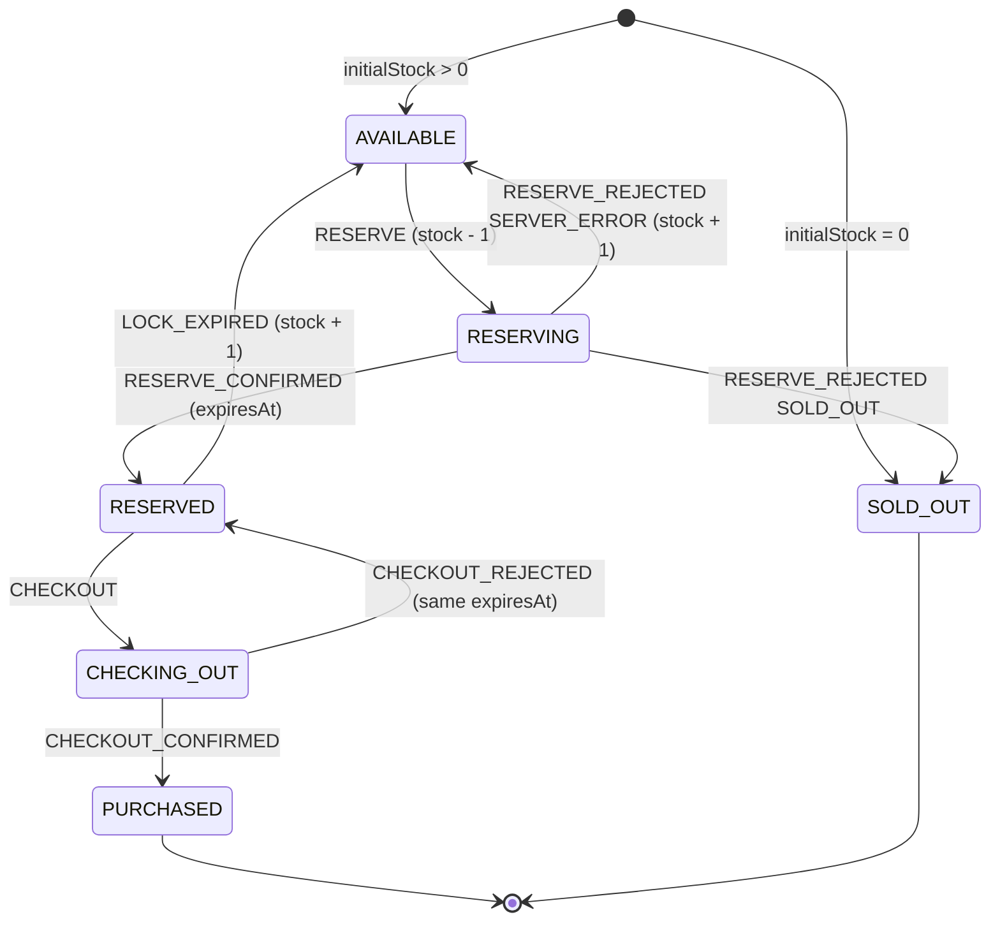

# HW3: High-Concurrency Flash-Sale E-Commerce Engine

Lab 02 homework 3. A Vietnam mega-sale simulation (Shopee / Lazada 11.11
style): a zero-drift sale countdown, an optimistic inventory lock modelled as
a finite state machine, and simulated rival buyers competing for the same
stock. Vanilla TypeScript + Vite, no UI framework, no runtime dependencies.

## Run

Needs Node 22+ (developed on 22.17).

```sh
npm install
npm run dev       # http://localhost:5103
npm run build     # tsc --noEmit + vite build
npm run preview   # serves dist/ on http://localhost:5103
npm test          # node:test unit tests (node --test --experimental-strip-types)
```

Dev and preview both use port 5103 with `strictPort`.

## Features

- Sale countdown `hh:mm:ss.ms` that stays accurate under load.
- Five mock products, prices in VND via `Intl.NumberFormat('vi-VN')`.
- Reserve (`Giữ hàng`) holds one unit with a 20 s lock; Checkout
  (`Thanh toán`) buys it. The UI updates optimistically and rolls back when
  the simulated server rejects.
- A lock countdown on each reserved card; an expired lock returns the unit.
- Rival buyers use the same mock server API, so sell-outs and lock expiry are
  real, not scripted.
- When the sale countdown reaches 0, Reserve is disabled and rivals stop.

## Inventory state machine

`transition(state, event)` in `src/inventory-machine.ts` is a pure function
that returns `{ok: true, state}` or `{ok: false, error}`. Any pair not drawn
below is rejected and never applied.



Design points:

- `stock` is the units left for others; it already excludes the unit this
  shopper holds, and never goes below 0. `AVAILABLE` with stock 0 rejects
  `RESERVE` instead of silently changing state.
- `LOCK_EXPIRED` while `CHECKING_OUT` is rejected: the in-flight checkout wins
  and the server's answer decides. If it is then rejected, the lock timer is
  re-armed, or the lock is expired at once if its time already passed.
- `PURCHASED` and `SOLD_OUT` are terminal. Late and duplicate events return
  `{ok: false}`.

## Timer design

`createAntiDriftTimer(durationMs, onTick)` in `src/anti-drift-timer.ts`
fixes `targetTime = Date.now() + durationMs` once, and every
`requestAnimationFrame` frame computes `remaining = targetTime - Date.now()`.
Nothing is decremented, so a late, skipped or throttled frame only makes the
next step bigger and the error never accumulates. A `setInterval` /
`setTimeout` countdown that subtracts a fixed step per tick drifts instead.
It returns a cleanup function that cancels the pending frame and is safe to
call twice.

Measured in a local Chrome run with the CPU throttled 6x plus a 3 s main
thread block: the anti-drift timer's maximum error was 0.9 ms, a naive
`setInterval` decrement was off by 3340.6 ms, and no ticks arrived after
cleanup. (Evidence files are kept locally, not in this repo.)

`formatTime()` in `src/format-time.ts` is a pure function; fractions round up
so the display reads zero only when time is really up.

## Optimistic lock and rollback

`src/sale-controller.ts` owns one FSM state per product. Every change goes
through `transition()`; a rejected transition changes nothing.

- `reserve(id)` applies `RESERVE` locally first, then calls the server and
  settles with `RESERVE_CONFIRMED` or `RESERVE_REJECTED`. A network error or
  abort is treated as `SERVER_ERROR` and rolls back.
- `checkout(id)` does the same with the server-issued lock id, which is kept
  outside the FSM.
- Each call has a token; answers for a superseded or disposed request are
  ignored. `dispose()` aborts in-flight calls.

## Lock expiry

When a product enters `RESERVED`, the controller starts an anti-drift timer
for `expiresAt - now`. It stops the timer on every exit from `RESERVED`
(checkout, expiry, dispose). At 0 it dispatches `LOCK_EXPIRED`, which releases
the unit. The per-frame lock time goes to the UI through
`subscribeLockTick`, so a full re-render is not triggered 60 times a second.

## Mock server and rivals

`src/mock-server.ts` is the authoritative server: promise-based `reserve` and
`checkout` with simulated latency (300 to 900 ms by default) and random
`SERVER_ERROR`s (20% by default), driven by an injectable seeded PRNG
(`mulberry32`) so tests are deterministic. Stock never goes below 0,
exhausted stock rejects with `SOLD_OUT`, each reservation gets its own
`lockId`, and calls accept an `AbortSignal`. Expired locks release stock.

`src/rivals.ts` runs simulated buyers against that same API: they reserve
random products every 0.7 to 1.8 s and about 70% of them check out; the rest
abandon the lock until it expires. After every settle, and on rival activity,
the displayed stock is re-read from `server.stockOf` (a UI-layer value; the
FSM contract has no stock-sync event). While a reserve is pending, the shown
stock is capped by the server's stock minus the pending unit, so it can fall
but never rise.

## Back/forward cache

The page does not tear down on `pagehide` when `persisted` is true. A
bfcache page is only frozen: `requestAnimationFrame` and timers resume on
restore, and the countdown recomputes from the fixed end time, so the sale
end is neither frozen nor reset. Teardown (timers, rivals, controller) runs
only when the page is really unloaded.

## Accessibility

- Semantic HTML: one `<main>`, `<header>`, `<section>` with headings, a `<ul>`
  of `<article>` cards, real `<button>`s.
- Ticking countdowns use `aria-live="off"` to avoid screen reader spam.
- Outcomes go to a polite `role="log"` that appends each message (newest 5
  kept). Only the shopper's own transitions and the sale end are announced;
  a sell-out caused by a rival stays visible on the card but is not read out.
- When a button disables itself, focus moves to the card's enabled button or
  the card, so keyboard focus is not lost.
- State is shown by text and a symbol, not by colour alone; visible
  `:focus-visible` outline; usable at 375 px width.
- All user-visible text is set via `textContent`; no `innerHTML`, no inline
  handlers, one delegated click listener.

## Known limitations

- `SOLD_OUT` is terminal per the FSM contract. After losing a last-unit race
  the card keeps "Hết hàng" even if a rival's abandoned lock later returns a
  unit to the server.
- In the mock server a lock id is a bearer token: whoever holds the id can
  check out that lock. There is no per-user identity.
- The lock countdown text freezes while `CHECKING_OUT`, and the displayed
  stock is not refreshed after the sale ends and rivals stop.
- The server is in-memory and simulated; a reload resets stock.

## Docs

- [`docs/project-rules.md`](docs/project-rules.md): working contract and
  coding rules.
- [`docs/TASK_DECOMPOSITION.md`](docs/TASK_DECOMPOSITION.md): work breakdown,
  one commit per task.
- [`docs/AI_FAILURE_AUDIT.md`](docs/AI_FAILURE_AUDIT.md): AI failure modes
  found, with detection and fixes.
